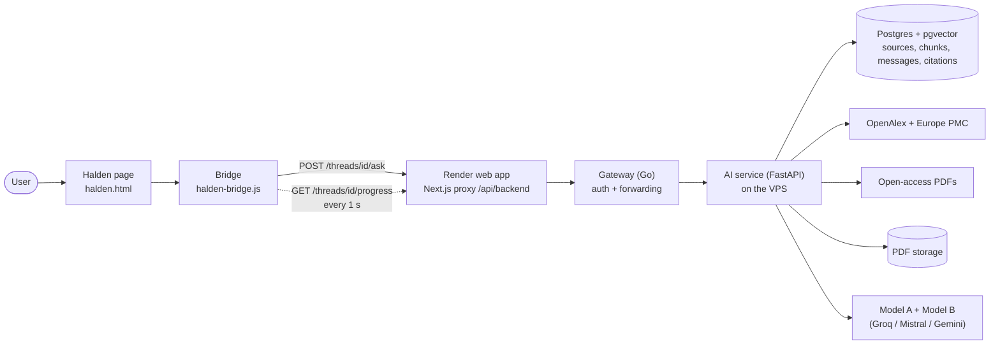
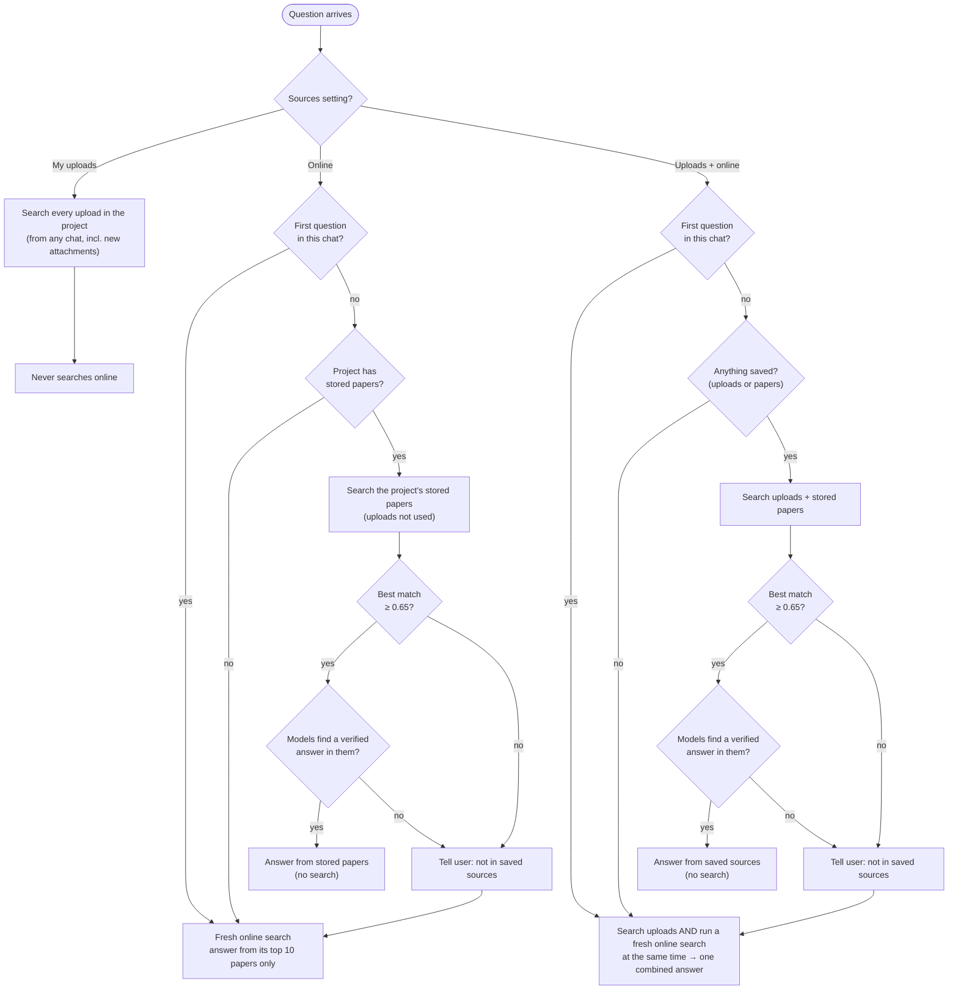
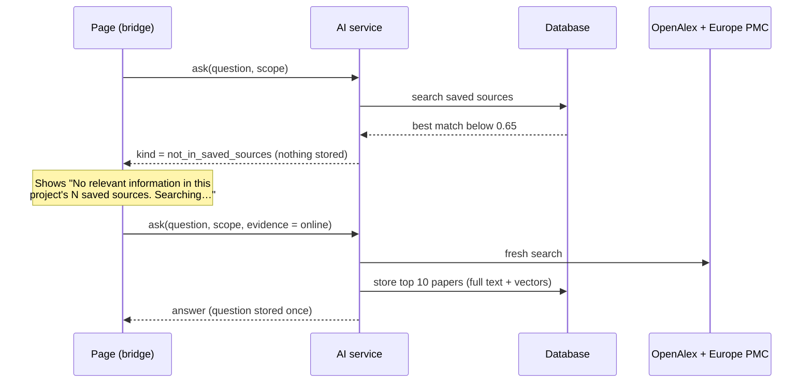
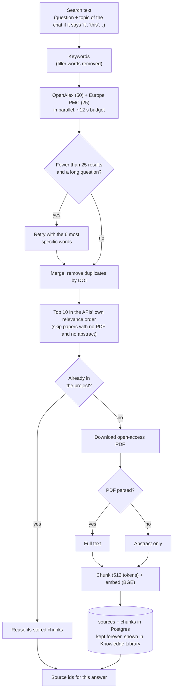
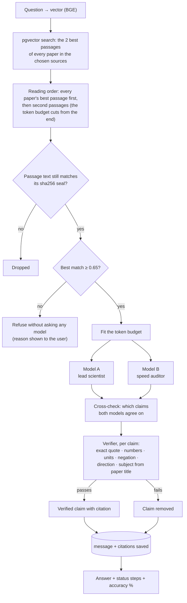
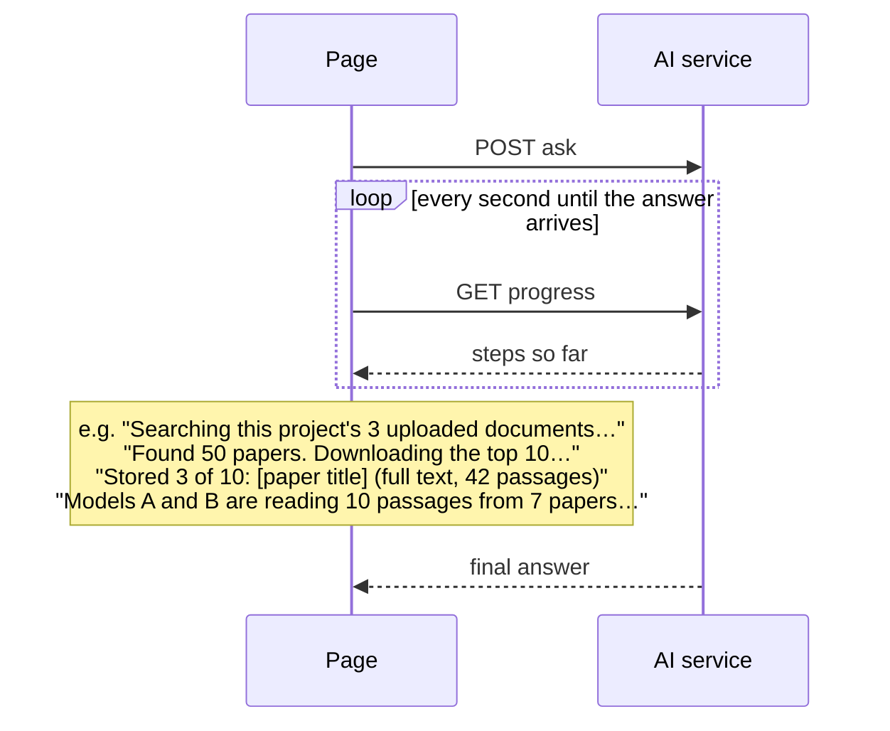

# Ask flow: from question to verified answer

These diagrams use Mermaid; GitHub and VS Code (with a Mermaid preview) draw them as graphics.
Code references: `services/ai/app/routes_tasks.py` (`ask`, `plan_evidence`, `search_and_store`), `apps/web/public/halden-bridge.js` (`runAsk`, `watchProgress`).

---

## 1. The whole system

---

## 2. Which sources answer the question (`plan_evidence`)

---

## 3. "Not in saved sources" (the user is told first)

---

## 4. Online search and storage (`search_and_store`)

---

## 5. From passages to a verified answer

---

## 6. Live progress (what the user sees while waiting)

---

## Refusal reasons the user can see

| Reason | When |
|---|---|
| `no_uploads` | My uploads, but the project has no uploaded documents |
| `online_search_failed` | The online search returned no papers (APIs down, rate-limited or nothing found) |
| `below_similarity_threshold` | Passages exist but none is close enough (best match < 0.65); no model is asked |
| `insufficient_evidence` (from the models) | Both models say the passages don't answer it; their reason is shown |
| `integrity_failure` | A stored passage no longer matches its seal |
